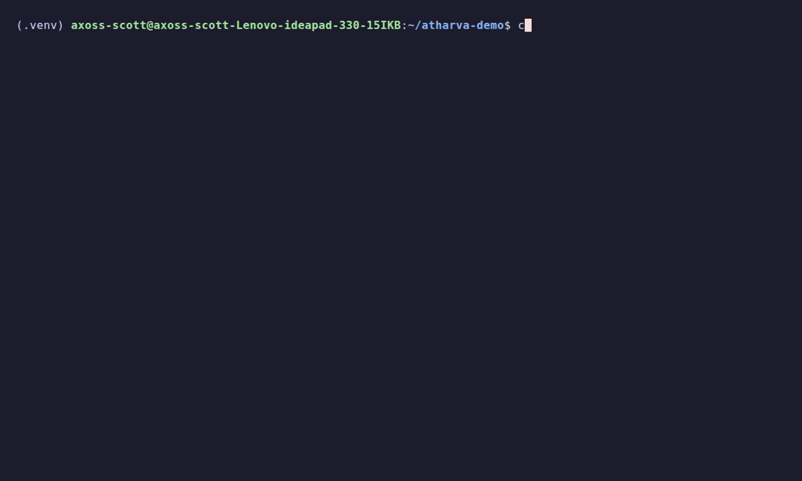

<h1 align="center">atharva 🪷</h1>

<p align="center">
  <b>Codeforces, but it lives in your terminal now.</b><br>
  fetch → test → emit → AC. no tabs. no mouse. no suffering.
</p>

<p align="center">
  
</p>

---

## why does this exist 🥲

it's 2:47 am. contest ends in 11 minutes.
you copy the sample input. paste it. copy the output. squint at two numbers.
alt-tab. submit. wait. refresh. refresh. **wrong answer on test 2.**

bro. enough.

atharva does all of that for you, from the terminal you already live in.
you just write code. the rest is handled. with love. 🫶

---

## install (30 seconds, promise)

```
pipx install atharva
```
don't have pipx yet?

```
sudo apt install pipx    # linux
brew install pipx        # mac
pip install pipx         # windows
pipx ensurepath          # then open a new terminal
```


you'll also need **Google Chrome** installed (atharva borrows it to talk to Codeforces, very respectfully).

then log in once, and never again:

```
cfx login
```

that's it. you're him now.

---

## the vibe check ✨

```
cfx fetch 1878E           # problem + samples, served hot 🍵
cfx test 1878E ans.cpp    # run every test, see EXACTLY what's off
cfx add 1878E             # paste your own evil edge case
cfx emit 1878E ans.cpp    # submit and watch it get judged, live
```

don't like `cfx`? type `atharva` instead. same app, more aura.

---

## what it actually does 🧠

**📖 statements you can actually read**
math becomes real symbols (`aᵢ ≤ 10⁹`, not `a_i \le 10^9`), samples sit side by side. your eyes will thank you.

**🔍 diffs that point at the crime scene**
on a wrong answer, atharva highlights *the exact values* that differ. green is what they wanted. red is what you gave them. no more playing spot-the-difference at 3 am.

**⏳ live judging, but make it pretty**
`Running on test 7...` with a little spinner, then a big colored verdict. you'll feel every test. emotionally.

**🧪 custom tests**
add your own edge cases. no expected answer? fine, atharva just shows you what your code printed, so you can eyeball it like a true sigma.

**🌍 five languages, zero setup**
atharva figures out the language from the file extension:

| file | runs locally with | submits as |
|---|---|---|
| `.cpp` | `g++ -std=c++20 -O2 -DLOCAL` | GNU G++23 |
| `.py` | PyPy 3 (or Python if you don't have it) | PyPy 3.10 |
| `.c` | `gcc -std=c11 -O2` | GNU GCC C11 |
| `.java` | `java` | Java 21 |
| `.rs` | `rustc -O` | Rust 2024 |

pro tip: anything inside `#ifdef LOCAL` runs on your machine and vanishes on the judge. debug prints, but invisible. lowkey magic.

---

## where your stuff lives 🏠

```
1878E/
  statement.md      the problem, readable anywhere
  tests/
    s1.in  s1.out   samples (fetch refreshes these)
    c1.in  c1.out   your custom tests (fetch never touches these, pinky promise)
  ans.cpp           your masterpiece
```

---

## small print, but friendly 📝

- **windows gang:** when pasting a custom test, finish with `Ctrl+Z` then `Enter` (instead of `Ctrl+D`).
- **login expired?** just run `cfx login` again. happens to the best of us.
- **during live contests**, Codeforces hides test data, so you'll see the test number but not the values. that's on them, not us 🤷
- atharva checks the Codeforces API at most once every 2 seconds. we play by the rules. good karma only.

---

## found a bug? 🐛

open an issue. be specific. bonus points for the problem code and the exact command you ran.
pull requests welcome. coffee's on me if it's a good one ☕

---

<p align="center">
  made with too much caffeine and too little sleep 🌙<br>
  <i>may your submissions be green and your rating go up only 📈</i>
</p>

<p align="center"><sub>MIT licensed. use it, fork it, love it.</sub></p>
